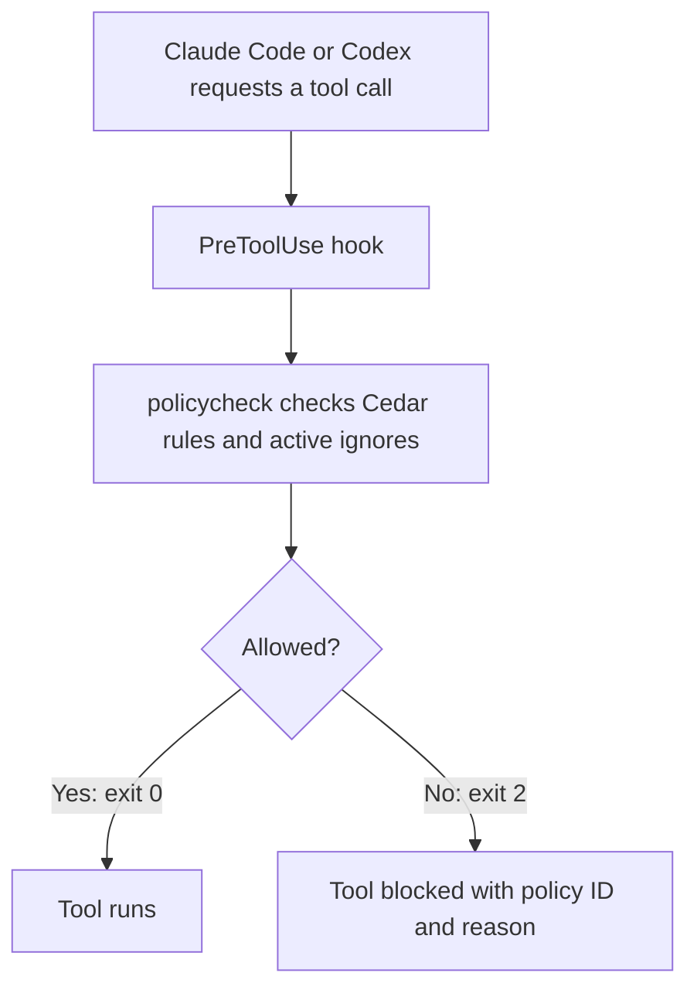

# policycheck

[](https://github.com/ipapast/policycheck/actions/workflows/test.yml)

`policycheck` checks tool calls from [Claude Code](https://claude.com/claude-code) and [Codex](https://learn.chatgpt.com/docs/hooks) against [Cedar](https://docs.cedarpolicy.com/) rules before they run. Each rule has an ID, an explanation and tests, so you can see why a call was blocked, add an exception for a project with an expiry date, and keep an audit log of policy matches.



The rules cover Claude Code's shell, file, search and fetch tools, and have also been tested with Codex CLI shell commands and native `apply_patch` edits. For a patch, every affected file is checked before any changes are made. MCP rules depend on the tool names and hook configuration; the [agent guide](docs/agents.md) describes the tested coverage.

## Why

Coding agents run shell commands and edit files on your behalf, usually with your credentials. Most of the time that is fine. The risk is the occasional bad call: a cleanup that deletes too much, a command that reads `~/.aws/credentials` "to debug", or a prompt injection hidden in a README or web page the agent was asked to read. The agent has the tools, so it just does it.

Claude Code and Codex have their own permission systems, and you should use them. `policycheck` is an extra layer that adds a few things they don't give you on their own:

- **Rules you can read.** Each rule is a small Cedar file with an ID and a plain explanation, so a block tells you exactly which rule fired and why, instead of a generic denial.
- **Rules you can test.** Every policy ships with test cases, so changing one doesn't quietly break another.
- **Exceptions that expire.** If a rule is in your way on one project, you can ignore it for that path with an end date, instead of turning the whole thing off.
- **A record.** An optional audit log shows which rules matched and which were overridden.

It is a guardrail, not a sandbox. The rules match on what the agent sends, so a determined agent can get around them. It catches mistakes and obvious bad behavior, and it works best next to real isolation like containers and least-privilege credentials. See [SECURITY.md](SECURITY.md).

## What it checks

The included policies cover operations that are easy to get wrong during coding, whether through a mistake or a prompt injection in a file the agent reads:

- **Destructive commands:** `rm -rf` on broad paths, `sudo`, `chmod 777`, disk tools, `kill -9`
- **Secrets:** SSH and cloud credentials, `.env` files, `credentials.json`, `.npmrc`, kubeconfig, private keys, environment dumps
- **Exfiltration and SSRF:** piping downloads into a shell, POSTing data out with curl, fetching localhost or cloud metadata URLs
- **Risky workflows:** force pushes, pushing to main, editing CI workflows or the agent's own settings, package publishing, mass deletes in AWS and Postgres

## How it works

The agent invokes `policycheck` through a `PreToolUse` hook, passing a JSON object with `tool_name` and `tool_input` on stdin. The checker evaluates the policies and project ignores, then returns exit code 0 to allow the call or exit code 2 to block it with a policy ID and explanation. When audit logging is enabled, it records matching rules, including violations allowed by an ignore.

`policycheck` is a standalone static binary with the default policies embedded, so it can run without a Go installation or network connection once built. You can [supply your own policy directory](docs/usage.md#custom-policies) to adapt the rules to your project.

## Quick start

Install with Go 1.24 or later:

```bash
go install github.com/ipapast/policycheck/cmd/policycheck@latest
```

By default, `go install` puts `policycheck` in `~/go/bin/`. Add your Go binary directory to `PATH` so the hook can find it:

```bash
export PATH=$PATH:$(go env GOPATH)/bin
```

Or download a prebuilt binary for Linux or macOS (amd64 or arm64) from the [Releases page](https://github.com/ipapast/policycheck/releases), make it executable, and put it on your `PATH`.

Or build from a clone (needs Go 1.24 or later):

```bash
git clone https://github.com/ipapast/policycheck.git
cd policycheck
go build -o policycheck ./cmd/policycheck
./policycheck test
```

`go build` writes the `policycheck` binary into the current directory, so run it as `./policycheck` or move it onto your `PATH`. `policycheck test` runs every rule's test cases and should end with `0 failed`.

### Check that it works

Before you wire it into an agent, confirm the binary runs and blocks something:

```bash
policycheck --version
echo '{"tool_name":"Bash","tool_input":{"command":"rm -rf /"}}' | policycheck; echo "exit=$?"
```

The second command should print `BLOCKED [CMD-001]: ...` and `exit=2`. If you get "command not found", your Go binary directory is not on `PATH` (see above).

### Claude Code

Add the hook to your project's `.claude/settings.json`:

```json
{
  "hooks": {
    "PreToolUse": [
      {
        "matcher": "",
        "hooks": [
          {
            "type": "command",
            "command": "policycheck"
          }
        ]
      }
    ]
  }
}
```

If `policycheck` cannot load its policies or parse the hook input, it returns exit code 2 and blocks the call with an error message.

### Codex

Add this to `~/.codex/hooks.json` for all projects, or `<repo>/.codex/hooks.json` for one project:

```json
{
  "hooks": {
    "PreToolUse": [
      {
        "matcher": "^(Bash|apply_patch)$",
        "hooks": [
          {
            "type": "command",
            "command": "policycheck"
          }
        ]
      }
    ]
  }
}
```

If `policycheck` is not on Codex's PATH, use its absolute path in `command`, for example `/Users/you/go/bin/policycheck`. Review and trust the hook through `/hooks` in the CLI or **Settings → Hooks** in the desktop app. Project-local hooks also require a trusted project. See the [Codex hooks documentation](https://learn.chatgpt.com/docs/hooks).

The [agent guide](docs/agents.md) covers test results, MCP configuration and coverage limits. There are also instructions for [dev containers](docs/dev-containers.md), [custom policies](docs/usage.md#custom-policies), [temporary exceptions](docs/usage.md#ignoring-policies) and [audit logging](docs/usage.md#audit-log).

## Included policies

<details>
<summary>All 30 policies</summary>

| ID | Blocks |
|---|---|
| `CMD-001` | rm -r/-rf on dangerous paths (/, ~, *) |
| `CMD-002` | find -delete on dangerous paths (rm -rf bypass) |
| `CMD-003` | sudo/su/doas privilege escalation |
| `CMD-004` | chmod 777 and recursive chown |
| `CMD-005` | privileged Docker containers |
| `CMD-006` | kill -9 |
| `CMD-007` | disk-level commands (dd, mkfs, fdisk, parted) |
| `DATA-001` | environment variable dumping |
| `DATA-002` | reading credential and cloud config files |
| `DATA-003` | reading .env files |
| `DATA-004` | writing to shell config and dotfiles |
| `DATA-005` | reading system authentication files |
| `DATA-006` | searching credential and secret files with Glob/Grep |
| `DATA-007` | reading credential and secret files (credentials.json, secrets.*, .npmrc, .netrc, kubeconfig, .pem/.key) |
| `NET-001` | piping downloads to shell execution |
| `NET-002` | data exfiltration via curl/wget POST |
| `NET-003` | accessing cloud metadata endpoints (SSRF risk) |
| `NET-004` | WebFetch to localhost, private network and internal URLs |
| `TOOL-001` | git force push |
| `TOOL-002` | modifying git remotes |
| `TOOL-003` | destructive git operations |
| `TOOL-004` | package publishing |
| `TOOL-005` | writing to CI/CD workflows |
| `TOOL-006` | editing agent settings and security files |
| `TOOL-007` | sending Slack messages via MCP |
| `TOOL-009` | pushing directly to main or master |
| `TOOL-010` | aws iam permission changes |
| `TOOL-011` | aws s3 mass deletion |
| `TOOL-012` | cdk deploy/destroy |
| `TOOL-013` | destructive psql commands (DROP, TRUNCATE) |

The `examples/` directory contains policies that need project-specific values before use. For example, `TOOL-008` restricts `git push` to a GitHub account; set the account name and include the file in your custom policy directory to enable it.

</details>

## Limitations

The rules match patterns in tool inputs, so their coverage depends on how an operation is expressed. The checker normalizes common shell wrappers, whitespace and recursive `rm` flags, and checks segments of chained commands, but it does not fully parse or execute the shell to determine what a command will do.

The command string given to `bash -c`, `sh -c` and `eval` is checked too, but variable expansion, encoded payloads, commands inside scripts and relative paths after `cd` can escape those checks. Named Git remotes are not resolved, and file writes through shell scripts are outside the patch adapter. Keep the agent's permissions and sandbox enabled to restrict filesystem and network access; [SECURITY.md](SECURITY.md) explains the limits of the policy checks.

## Documentation

- [Using policycheck](docs/usage.md) - custom policies, ignoring a policy, audit log, versions
- [Writing and testing policies](docs/writing-policies.md) - Cedar basics, policy naming, context fields, contributing
- [Dev containers and other sandboxes](docs/dev-containers.md)
- [Codex and other agents](docs/agents.md)
- [SECURITY.md](SECURITY.md) - limits of pattern matching and how to report a bypass

## License

Apache-2.0. See [LICENSE](LICENSE).
